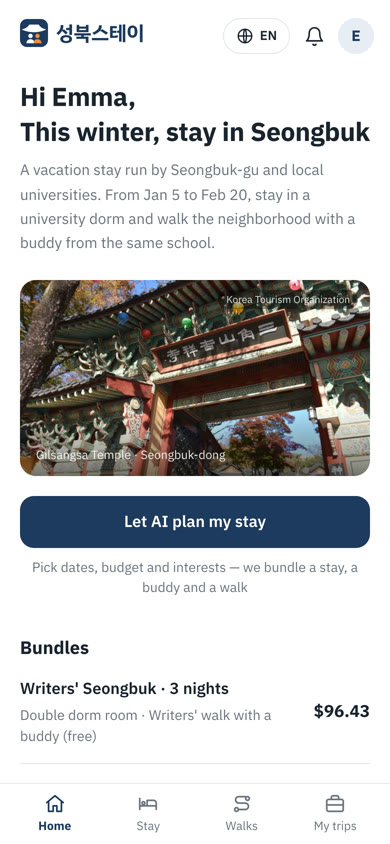
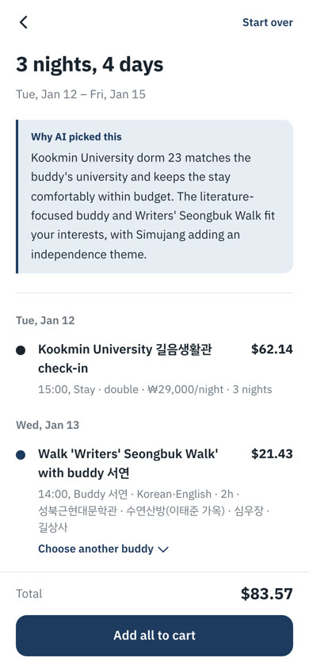
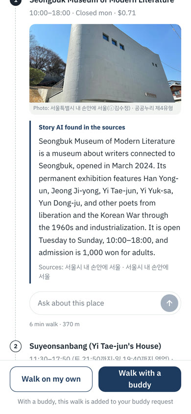
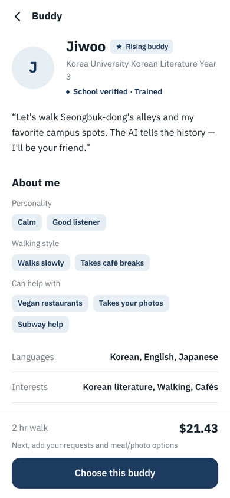
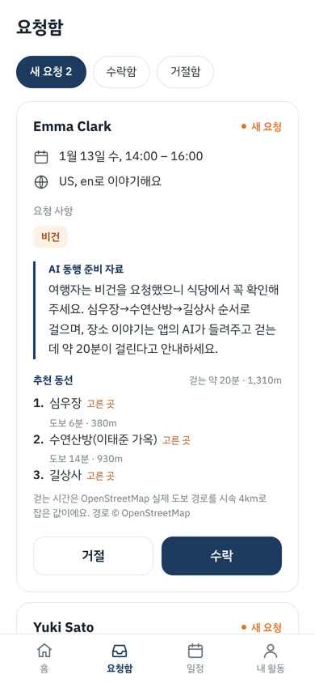
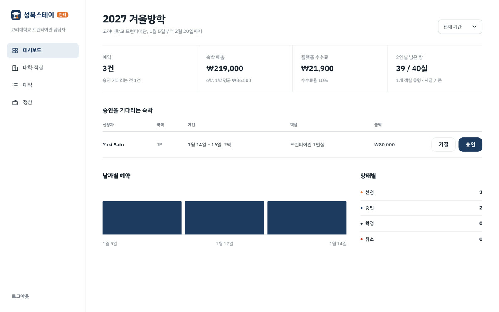

# SB Stay (성북스테이)

**방학 동안 비는 성북구 대학 기숙사에 묵고, 같은 학교 대학생 버디와 동네를 걷는 외국인 체류형 관광 플랫폼.**
일정은 AI가 짜 주고, 장소 이야기는 확인된 자료에서만 가져옵니다.

2026 SB 스타트업 네트워킹 페스티벌 「AI 기반 지역문제 해결 해커톤」 출품작

| 서비스 | API 문서 | 홍보 영상 |
|---|---|---|
| https://sbstay.site | https://api.sbstay.site/docs | [보기 (46초)](https://sbstay.site/promo/sbstay-promo.mp4) |

## 홍보 영상

[](https://sbstay.site/promo/sbstay-promo.mp4)

▶ [소리와 함께 영상 보기](https://sbstay.site/promo/sbstay-promo.mp4) (1920×1080, 46.5초). 위 미리보기는 소리 없는 GIF예요.

## 왜 만들었나

| 문제 | 해결 |
|---|---|
| 성북구는 볼 곳이 많지만 숙박시설은 **54곳**뿐 (중구 498곳, 서울 자치구 평균 113.5곳) | 방학 동안 비는 **대학 기숙사 정원 8,706명**(성북 7개 대학)을 숙소로 |
| 외국인이 동네를 혼자 걷기 어렵다 | **같은 학교 대학생 버디**가 숙박마다 1명 함께 |
| AI 관광 안내는 지어낸 정보가 섞인다 | 운영시간·가격·좌표는 DB 값, 장소 이야기는 **출처가 있는 자료에서만** (없으면 "자료에 없다") |

숫자 출처: 한국관광공사 데이터랩(2026.10), 대학알리미(2025.4.1)

## 주요 기능

**여행자 (모바일 웹 · 한국어/영어, 원화/달러)**
- AI 여행 설계: 날짜·예산·관심사를 넣으면 기숙사 + 버디 + 산책 코스를 한 번에 묶어 줌
- 기숙사 숙박, 버디 고르기(성향·걷는 속도·도와줄 수 있는 것), 요청 사항(식단·알레르기·가고 싶은 곳)
- 무료 AI 산책 코스: 지도, 출처가 붙은 장소 이야기, 장소별 질문
- 결제(토스페이먼츠·PayPal 테스트 결제), 내 여행·앨범·후기·신고

**버디 (대학생)**
- 6단계 지원: 학교 메일 또는 성북구 거주 인증 → 약속 → 교육 영상 → 퀴즈 → 소개 → 운영팀 승인
- 요청함에서 수락·거절, AI 동행 준비 자료, 구글 캘린더 연동, 식사비 청구, 활동 기록, 등급별 정산(70~80%)

**대학 담당자 · 운영자 (웹)**
- 대학 담당자: 자기 학교 기숙사 방·숙박 신청 승인
- 운영자: 버디 지원 심사, 예약·식사비·신고 처리, 코스 관리, 정산

## 화면

| 여행자 홈 | AI 여행 설계 | 장소 이야기 (출처) | 버디 소개 | 버디 요청함 |
|---|---|---|---|---|
|  |  |  |  |  |



## 기술 스택

| 영역 | 사용 |
|---|---|
| 프론트 | Next.js 16 (App Router), React 19, TypeScript, Tailwind CSS v4 — Vercel |
| 백엔드 | FastAPI, SQLAlchemy 2, Alembic, PostgreSQL 16, Python 3.12 — Railway |
| AI | OpenAI 호환 LLM API(모델은 `.env`), 공공데이터 기반 RAG |
| 외부 연동 | 구글 로그인·캘린더, 카카오맵, 토스페이먼츠, PayPal, 한국관광공사 TourAPI |
| 테스트 | pytest (GitHub Actions, PR마다) |

## 폴더 구조

```
frontend/   Next.js — 여행자·버디 모바일 웹 + 대학 담당자·운영자 웹
  src/app/(tourist)  여행자 화면   src/app/buddy  버디 화면   src/app/admin  관리자 화면
  src/lib/mock       백엔드 없이 도는 목 데이터 (NEXT_PUBLIC_USE_MOCK=true)
backend/    FastAPI
  app/routers  API   app/services  예약 규칙·AI·결제·정산   app/seeds  데모 데이터   tests  pytest
docs/       API 명세·ERD·배포·데모 계정·화면 연결도 (아래 문서 표)
```

## 로컬 실행

**1. DB** — 로컬 PostgreSQL 16이 있으면 아래, 없으면 `docker compose up -d db` (같은 계정/DB)
```bash
psql -h localhost -d postgres -c "CREATE ROLE sbstay WITH LOGIN PASSWORD 'sbstay' CREATEDB;"
psql -h localhost -d postgres -c "CREATE DATABASE sbstay OWNER sbstay;"
```

**2. 백엔드** — http://localhost:8000/docs
```bash
cd backend
cp .env.example .env            # 키 채우기
uv sync --extra dev
uv run alembic upgrade head     # 스키마
uv run python -m app.seeds      # 데모 데이터 (기존 데이터를 지우고 다시 넣음)
uv run uvicorn app.main:app --reload --port 8000
uv run pytest -q                # 테스트
```

**3. 프론트** — http://localhost:3000
```bash
cd frontend
cp .env.example .env.local      # 백엔드에 붙이려면 NEXT_PUBLIC_USE_MOCK=false
npm install
npm run dev
```
`NEXT_PUBLIC_USE_MOCK=true`(예시 기본값)면 백엔드 없이 목 데이터로 화면을 볼 수 있어요.

## 데모 계정 (비밀번호 `demo1234`)

첫 화면(https://sbstay.site)의 데모 버튼을 누르면 바로 로그인돼요.

| 역할 | 이메일 | 들어가면 |
|---|---|---|
| 여행자 | emma@example.com (영어 화면), yuki@example.com | `/home` |
| 버디 | jiwoo@a-univ.ac.kr | `/buddy` |
| 대학 담당자 (고려대학교) | admin@a-univ.ac.kr | `/admin` |
| 운영자 | operator@sbstay.app | `/admin` |

- 데모 '오늘'은 2027-01-14 (Emma는 1/12–15 숙박 중, 1/13 지우와 동행)
- 데모 계정은 역할을 바꾸거나 버디 신청을 할 수 없어요. 버디 신청은 새 계정으로 해 주세요.
- 전체 계정과 시드 이야기: [docs/demo-accounts.md](docs/demo-accounts.md)

## 문서

| 문서 | 내용 |
|---|---|
| [docs/api-spec.md](docs/api-spec.md), [docs/api-detail/](docs/api-detail) | API 명세 |
| [docs/erd.md](docs/erd.md) | DB 구조 |
| [docs/v3/CHANGES.md](docs/v3/CHANGES.md), [docs/v3/screen-flow.md](docs/v3/screen-flow.md) | v3 변경 사항, 화면 연결도 |
| [docs/payments.md](docs/payments.md) | 결제·환불 |
| [docs/deploy.md](docs/deploy.md) | 배포 (Vercel · Railway · 도메인) |
| [docs/photo-credits.md](docs/photo-credits.md) | 사진 출처 |

## 개발 규칙

- 흐름: `feat/<이니셜>-<기능>` → PR → `develop` (pytest 통과 필수) → `main`. main에 병합되면 프론트(Vercel)·백엔드(Railway)가 자동 배포
- 명세를 먼저 고치고 코드를 바꾼다. main은 항상 실행 가능한 상태
- API 키는 `.env`에만, 깃허브에 올리지 않는다
- 자세한 규칙: [docs/backend-plan.md](docs/backend-plan.md)

## 출처

- 홍보 영상 사진: 삼군부 총무당 — 오모군, CC BY 4.0 · 고려대 프런티어관 — Mimacds, CC BY-SA 3.0 (위키미디어 공용). 효과음: HyperFrames 기본 사운드
- 앱 안의 장소·기숙사 사진 출처는 [docs/photo-credits.md](docs/photo-credits.md)
