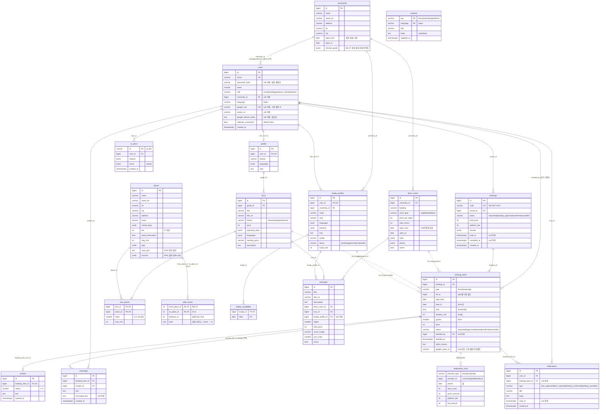

# 성북스테이(가칭) ERD v1

- 기준: `docs/api-spec.md` 8장 "데이터베이스" 13개 테이블 + 엔드포인트를 보고 추가한 4개 테이블 + 뷰 1개 · PostgreSQL · 2026-11-05
- 그림: `design/sbstay-erd.excalidraw` (`python3 design/gen_erd.py` 로 재생성). 이 문서의 컬럼과 생성기의 `TABLES` 는 같아야 한다.
- 추가한 것: `packages`(HM-01 추천 패키지), `notifications`(BK-10 알림), `contents`(CM-01/AD-09 정적 콘텐츠), `ai_plans`(AI-01 `plan_id` 보관). `settlements`(AD-06/BD-07)는 별도 테이블 대신 `booking_items` 집계 뷰 `settlements_view` 로 둔다.
- 스펙 대비 컬럼 보강: `universities.checkin_guide`(BK-07), `bookings.cancelled_at`(BK-05), `booking_items.duration_min`·`guests`(BK-01 요청 본문), `reviews.created_at`, `messages.created_at`.
- 제외(상수/시드로 대체): AD-10 설정(수수료율 `fee_rate` 0.1 상수), AD-08 숙박신고(`bookings.traveler` + dorm 항목에서 즉석 CSV).
- 구글 OAuth·캘린더(v1.1, AU-01/06/07/08 · BK-04/05): `users.google_sub`·`avatar_url`·`google_refresh_token`·`calendar_connected`, `booking_items.google_event_id` 추가. `password_hash`는 null 허용(데모 계정만).

## 1. 다이어그램 (Mermaid)



## 2. 공통 규칙

- 역할 `users.role`: `tourist` | `buddy` | `guide` | `univ_admin` | `operator`. `buddy`·`guide`·`univ_admin` 은 `university_id` 필수, `tourist`·`operator` 는 null.
- 상태
  - `bookings.status`: `requested` → `partially_approved` → `confirmed` | `cancelled`. 모든 항목이 `approved`/`confirmed` 면 `confirmed`. 결제는 상태가 아니라 `paid_at` 타임스탬프(BK-06 목업).
  - `booking_items.status`: `requested` → `approved` | `rejected` → `confirmed` → `cancelled`. 투어 항목은 생성 시 바로 `confirmed`(BK-01). `rejected` 는 해당 항목만 제외.
  - `buddy_profiles.status`: `pending` → `approved` | `suspended` (AD-04).
- 타입 `booking_items.type`: `dorm` | `tour` | `buddy`. BK-04 승인 권한은 type 으로 결정 — dorm→`univ_admin`(해당 `dorm_rooms.university_id`), tour→`guide`(해당 `tours.guide_id`), buddy→`buddy`(해당 `buddy_profiles.user_id`), `operator` 전체.
- 금액은 KRW 정수. `platform_fee = round(total_price * 0.1)` (AD-10 수수료율은 상수).
- 인증: 기본은 구글 OAuth(AU-01) → `users.google_sub` 로 식별, 우리 JWT 발급. `password_hash` 는 시드 데모 계정(AU-05)만 가진다. 구글 캘린더 범위는 버디가 B3 에서 연동할 때 증분 요청(AU-07) → `google_refresh_token`(암호화)·`calendar_connected`.
- 캘린더 푸시(단방향): BK-04 로 buddy/guide 항목이 `confirmed` 가 되고 공급자가 `calendar_connected` 면 이벤트 생성 → `booking_items.google_event_id`. BK-05 취소 시 삭제. 실패해도 상태 전이는 성공(로그만).
- `jsonb` 컬럼은 해커톤 편의용 배열/객체. `languages`·`interests`·`tags`·`rules`·`photos`·`operating_days`·`closed_days` 는 문자열 배열.

## 3. 테이블별 컬럼

### users — 사용자 (전 역할 공통)
| 컬럼 | 타입 | 제약/설명 |
|---|---|---|
| id | bigserial | PK |
| email | varchar(255) | UNIQUE, NOT NULL. 구글 프로필 이메일 또는 데모 계정 ID. AU-01 upsert 시 시드 계정 연결 키 |
| password_hash | varchar(255) | NULL 허용 (bcrypt). 데모 계정(AU-05)만 사용, 구글로 만든 계정은 null |
| name | varchar(100) | NOT NULL |
| role | varchar(20) | NOT NULL. `tourist`/`buddy`/`guide`/`univ_admin`/`operator` |
| university_id | bigint | FK → universities.id, NULL 허용 (buddy/guide/univ_admin 소속) |
| language | varchar(2) | NOT NULL, default `ko`. `ko`/`en` (AU-04) |
| google_sub | varchar(64) | UNIQUE, NULL 허용. 구글 계정 고유 id(`sub`). AU-01 upsert 키 |
| avatar_url | varchar(500) | NULL 허용. 구글 프로필 사진 (AU-01) |
| google_refresh_token | text | NULL 허용. `calendar.events` 범위 refresh token, `TOKEN_ENCRYPTION_KEY` 로 암호화 저장 (AU-07). API 응답에 절대 노출 금지 |
| calendar_connected | bool | NOT NULL, default false. AU-07 연동 시 true, AU-08 해제 시 false. BK-04/05 캘린더 푸시 조건 |
| created_at | timestamptz | NOT NULL, default now() |

### universities — 대학
| 컬럼 | 타입 | 제약/설명 |
|---|---|---|
| id | bigserial | PK |
| name | varchar(100) | NOT NULL (한글명) |
| name_en | varchar(100) | 영문명 |
| address | varchar(255) | |
| lat, lng | numeric(9,6) | 지도 표시 좌표 |
| open_from, open_to | date | 방학 중 개방 기간 (DM-01, DM-06 수정) |
| checkin_guide | jsonb | BK-07 체크인 안내: 기숙사 위치·입실 절차·비상연락처 (스펙 보강) |

### dorm_rooms — 기숙사 객실
| 컬럼 | 타입 | 제약/설명 |
|---|---|---|
| id | bigserial | PK |
| university_id | bigint | FK → universities.id, NOT NULL |
| building | varchar(100) | 건물명 (예: 프런티어관) |
| room_type | varchar(20) | `single`/`double`/`twin` |
| price_per_night | int | KRW |
| total_rooms | int | 총 객실 수. 남은 객실 = total_rooms − 해당 날짜에 `approved`/`confirmed` 인 dorm 항목 수 (DM-03) |
| open_from, open_to | date | NULL 이면 대학 개방 기간을 따름 |
| rules | jsonb | 이용 규칙 문자열 배열 |
| photos | jsonb | 사진 URL 배열 |
| active | bool | default true. false 면 목록 제외 (DM-05) |

### guides — 해설사
| 컬럼 | 타입 | 제약/설명 |
|---|---|---|
| id | bigserial | PK |
| user_id | bigint | FK → users.id, UNIQUE (users 와 1:1, role=`guide`) |
| license | varchar(100) | 자격 (예: 관광통역안내사) |
| languages | jsonb | 가능 언어 배열 |
| intro | text | 소개 |

### tours — 투어 코스
| 컬럼 | 타입 | 제약/설명 |
|---|---|---|
| id | bigserial | PK |
| guide_id | bigint | FK → guides.id, NOT NULL |
| title, title_en | varchar(200) | 코스명 한/영 |
| theme | varchar(30) | `literature`/`independence`/… (TR-01 `?theme` 필터) |
| price | int | KRW, 1인 (v3: 0) |
| (v3.5) | | `duration_min` 칸 삭제 — 걸리는 시간은 장소 좌표·머무는 시간으로 계산 (`services/courses.py`) |
| operating_days | jsonb | `["sat","sun"]` — TR-01 `?date` 는 요일로 변환해 필터 |
| languages | jsonb | 해설 언어 배열 (TR-01 `?language`) |
| meeting_point | varchar(255) | 집결지 |
| description | text | 소개글 |

### tour_places — 코스-장소 (순서)
| 컬럼 | 타입 | 제약/설명 |
|---|---|---|
| tour_id | bigint | PK, FK → tours.id (ON DELETE CASCADE) |
| place_id | bigint | PK, FK → places.id |
| order | smallint | 코스 내 순서. SQL 예약어이므로 DDL 에서는 `"order"` 또는 `seq` 로. UNIQUE(tour_id, order) |
| stay_min | int | 장소 체류 시간 |

### places — 장소 (+ RAG 문서)
| 컬럼 | 타입 | 제약/설명 |
|---|---|---|
| id | bigserial | PK |
| name, name_en | varchar(200) | 장소명 한/영 |
| lat, lng | numeric(9,6) | 좌표 (LLM 생성 금지, DB 값 사용) |
| address | varchar(255) | |
| hours | varchar(100) | 운영시간 텍스트 (예: `10:00-18:00`) |
| closed_days | jsonb | 휴관 요일 배열 |
| fee | int | 입장료 KRW, 0=무료 |
| need_reservation | bool | 사전 예약 필요 여부 |
| stay_min | int | 권장 체류 시간 |
| tags | jsonb | 태그 배열 (관심사 매칭) |
| story_doc | text | **RAG 문서 원문**. AI-02 `/ai/story` 가 이 텍스트만 근거로 답한다 (밖이면 `grounded=false`). 길면 문단 단위로 청크 테이블 분리 가능 |
| sources | jsonb | **RAG 출처** `[{title, url}]`. AI-02 응답 `sources` 로 그대로 반환 |

### walk_routes — 두 장소 사이 실제 도보 경로 (v3.8, Alembic `v3h_walk_routes`)
OpenStreetMap 도보 경로(OSRM `routing.openstreetmap.de/routed-foot`)를 `scripts/fetch_walk_routes.py`로 **미리** 받아 `app/seeds/data/walk_routes.json` → 시드로 넣는다. 앱은 요청 중에 외부 서버를 부르지 않는다. 지도 자료 © OpenStreetMap contributors (ODbL).

| 컬럼 | 타입 | 제약/설명 |
|---|---|---|
| from_place_id | int | PK, FK → places.id. 쌍의 **작은** id |
| to_place_id | int | PK, FK → places.id. 쌍의 큰 id (인덱스). CHECK(from_place_id < to_place_id) → 한 쌍에 한 줄 |
| distance_m | int | 실제 도보 거리 m (정수) |
| path | json | `[[위도, 경도], ...]` 소수 6자리, from → to 방향 (반대 방향은 뒤집어 쓴다) |

### buddy_profiles — 대학생 버디
| 컬럼 | 타입 | 제약/설명 |
|---|---|---|
| id | bigserial | PK |
| user_id | bigint | FK → users.id, UNIQUE (1:1, role=`buddy`) |
| university_id | bigint | FK → universities.id, NOT NULL (AD-03 소속 버디 조회) |
| major | varchar(100) | 전공 (BD-01 `?major`) |
| year | smallint | 학년 |
| languages | jsonb | 언어 배열 (BD-01 `?language`) |
| interests | jsonb | 관심사 배열 (BD-01 `?interest`, AI-03 매칭) |
| intro | text | 소개 |
| avatar | varchar(255) | 일러스트 파일명 |
| status | varchar(20) | `pending`/`approved`/`suspended`. BD-01 은 `approved` 만 노출 |
| hourly_fee | int | 시간당 활동비 KRW (팀 결정: 유급/무급) |

### buddy_availability — 버디 가능 날짜
| 컬럼 | 타입 | 제약/설명 |
|---|---|---|
| buddy_id | bigint | PK, FK → buddy_profiles.id (ON DELETE CASCADE) |
| date | date | PK. BD-04 는 본인 행 전체 교체(delete + insert) |

### packages — 홈 추천 패키지 (추가, HM-01)
| 컬럼 | 타입 | 제약/설명 |
|---|---|---|
| id | bigserial | PK |
| title, title_en | varchar(200) | 패키지명 한/영 |
| description | text | 소개 |
| dorm_room_id | bigint | FK → dorm_rooms.id |
| tour_id | bigint | FK → tours.id |
| buddy_profile_id | bigint | FK → buddy_profiles.id, NULL 허용 (버디는 AI 매칭으로 대체 가능) |
| nights | smallint | 숙박 일수 |
| total_price | int | 표시 가격 KRW (시드 값) |
| cover_image | varchar(255) | |
| sort_order | smallint | 홈 노출 순서 |
| active | bool | default true |

### bookings — 통합 예약
| 컬럼 | 타입 | 제약/설명 |
|---|---|---|
| id | bigserial | PK |
| code | varchar(20) | UNIQUE. 표시용 예약번호 `SB-2027-0112` |
| tourist_id | bigint | FK → users.id, NOT NULL (role=`tourist`) |
| status | varchar(30) | `requested`/`partially_approved`/`confirmed`/`cancelled`. 항목 상태로부터 재계산 |
| total_price | int | 항목 price 합계 KRW |
| platform_fee | int | total_price × 0.1 |
| traveler | jsonb | BK-01 `traveler` {name, nationality, email, passport_no, emergency_contact} — AD-08 숙박신고 원천 |
| paid_at | timestamptz | NULL. BK-06 결제 시각 (목업) |
| cancelled_at | timestamptz | NULL. BK-05 취소 시각 (스펙 보강) |
| created_at | timestamptz | NOT NULL, default now() |

### booking_items — 예약 항목 (dorm / tour / buddy)
| 컬럼 | 타입 | 제약/설명 |
|---|---|---|
| id | bigserial | PK |
| booking_id | bigint | FK → bookings.id, NOT NULL (ON DELETE CASCADE) |
| type | varchar(10) | `dorm`/`tour`/`buddy` |
| ref_id | bigint | **다형 참조**: `type=dorm` → dorm_rooms.id, `type=tour` → tours.id, `type=buddy` → buddy_profiles.id. DB FK 제약 없음, 서비스 계층에서 type 별로 존재 검증 |
| date_from | date | dorm 체크인 / tour·buddy 이용일 |
| date_to | date | dorm 체크아웃. 그 외 NULL |
| time | time | tour·buddy 시작 시각. dorm 은 NULL |
| duration_min | int | buddy 동행 시간 (BK-01, 스펙 보강) |
| guests | smallint | dorm 인원 (BK-01, 스펙 보강) |
| price | int | 항목 금액 KRW (dorm = 박수 × price_per_night) |
| status | varchar(20) | `requested`/`approved`/`rejected`/`confirmed`/`cancelled`. tour 는 생성 시 `confirmed` |
| decided_by | bigint | FK → users.id, NULL. BK-04 승인·거절한 공급자/운영자 |
| decided_at | timestamptz | NULL |
| reject_reason | text | NULL. BK-04 `reason` |
| google_event_id | varchar(100) | NULL. 공급자(buddy/guide) 구글 캘린더에 만든 이벤트 id (BK-04 확정 시 생성, BK-05 취소 시 삭제). dorm 항목은 항상 NULL |

### reviews — 리뷰
| 컬럼 | 타입 | 제약/설명 |
|---|---|---|
| id | bigserial | PK |
| booking_item_id | bigint | FK → booking_items.id, UNIQUE (항목당 리뷰 1개). 작성자는 booking.tourist_id 로 유도 |
| rating | smallint | 1~5 (CHECK) |
| text | text | |
| created_at | timestamptz | default now() (스펙 보강) |

TR-04 `/tours/{id}/reviews` = reviews ⋈ booking_items(type=`tour`, ref_id=id). BD-02 의 rating/review_count 도 같은 방식으로 buddy 항목을 집계.

### messages — 버디 채팅
| 컬럼 | 타입 | 제약/설명 |
|---|---|---|
| id | bigserial | PK |
| booking_item_id | bigint | FK → booking_items.id, NOT NULL. buddy 항목이 채팅방 단위 (BK-09) |
| sender_id | bigint | FK → users.id (관광객 또는 버디) |
| text | text | 원문 |
| translated_text | text | NULL. 자동 번역 결과 (예정) |
| created_at | timestamptz | default now() (스펙 보강) |

### notifications — 알림 (추가, BK-10)
| 컬럼 | 타입 | 제약/설명 |
|---|---|---|
| id | bigserial | PK |
| user_id | bigint | FK → users.id, NOT NULL (수신자) |
| booking_item_id | bigint | FK → booking_items.id, NULL 허용 |
| type | varchar(30) | `item_approved`/`item_rejected`/`booking_confirmed`/`booking_cancelled` |
| title | varchar(200) | |
| body | text | |
| read_at | timestamptz | NULL = 안 읽음 |
| created_at | timestamptz | default now(). 발송은 MVP 제외, 상태 변경 시 행만 생성 |

### contents — 정적 콘텐츠 (추가, CM-01 / AD-09)
| 컬럼 | 타입 | 제약/설명 |
|---|---|---|
| key | varchar(30) | PK(복합). `terms`/`refund`/`support`/`intro` |
| language | varchar(2) | PK(복합). `ko`/`en` |
| title | varchar(200) | |
| body | text | markdown. 시드 데이터로 채움 |
| updated_at | timestamptz | |

### ai_plans — AI 일정 결과 (추가, AI-01)
| 컬럼 | 타입 | 제약/설명 |
|---|---|---|
| id | varchar(20) | PK. 응답의 `plan_id` (예: `pl_8f2`) |
| user_id | bigint | FK → users.id |
| request | jsonb | AI-01 요청 본문 (기간·예산·관심사) |
| result | jsonb | AI-01 응답 `days[]` + `reason`. T3→T5 에서 예약 항목으로 변환 |
| created_at | timestamptz | default now(). 해커톤에선 메모리 캐시로 대체 가능 |

### settlements_view — 정산 (VIEW, AD-06 / BD-07 / AD-01)
| 컬럼 | 타입 | 제약/설명 |
|---|---|---|
| provider_type | varchar | `dorm`/`tour`/`buddy` (= booking_items.type) |
| provider_id | bigint | dorm → dorm_rooms.university_id, tour → tours.guide_id, buddy → booking_items.ref_id |
| period | date | 월 (date_trunc('month', date_from)) |
| item_count | int | 건수 |
| gross_amount | int | SUM(price) — status ∈ (`approved`, `confirmed`) |
| platform_fee | int | gross_amount × 0.1 |
| net_amount | int | gross_amount − platform_fee |

```sql
CREATE VIEW settlements_view AS
SELECT bi.type AS provider_type,
       CASE bi.type WHEN 'dorm' THEN d.university_id WHEN 'tour' THEN t.guide_id ELSE bi.ref_id END AS provider_id,
       date_trunc('month', bi.date_from)::date AS period,
       COUNT(*) AS item_count, SUM(bi.price) AS gross_amount,
       ROUND(SUM(bi.price) * 0.1) AS platform_fee, SUM(bi.price) - ROUND(SUM(bi.price) * 0.1) AS net_amount
FROM booking_items bi
LEFT JOIN dorm_rooms d ON bi.type = 'dorm' AND d.id = bi.ref_id
LEFT JOIN tours t ON bi.type = 'tour' AND t.id = bi.ref_id
WHERE bi.status IN ('approved', 'confirmed')
GROUP BY 1, 2, 3;
```

## 4. 관계 설명

| 관계 | 카디널리티 | 설명 |
|---|---|---|
| universities → users | 1 : N | 공급자 계정의 소속 대학. `univ_admin` 권한 범위 = 같은 `university_id` |
| universities → dorm_rooms | 1 : N | 대학별 객실. 개방 기간은 대학값을 객실값이 덮어씀 |
| universities → buddy_profiles | 1 : N | AD-03 소속 버디 조회 |
| users → guides / buddy_profiles | 1 : 0..1 | 역할별 확장 프로필 (`user_id` UNIQUE) |
| guides → tours | 1 : N | 해설사의 코스 |
| tours ↔ places (tour_places) | N : M | 코스 안 장소 순서·체류 시간 |
| places ↔ places (walk_routes) | N : M | v3.8 두 장소 사이 실제 도보 경로 (한 쌍 한 줄, 작은 id → 큰 id) |
| buddy_profiles → buddy_availability | 1 : N | 가능 날짜. BD-01 `?date` 필터 |
| users(tourist) → bookings | 1 : N | 관광객의 예약 |
| bookings → booking_items | 1 : N | 예약 하나 = 숙박·투어·버디 항목 묶음 |
| booking_items → dorm_rooms / tours / buddy_profiles | N : 1 (다형) | `(type, ref_id)` 로 가리킴. DB FK 없음 |
| users → booking_items.decided_by | 1 : N | 승인·거절한 공급자 |
| booking_items → reviews | 1 : 0..1 | 항목당 리뷰 1개 |
| booking_items → messages | 1 : N | buddy 항목이 채팅방 |
| booking_items / users → notifications | 1 : N | 상태 변경 알림 |
| dorm_rooms / tours / buddy_profiles → packages | 1 : N | 홈 추천 묶음 (시드) |
| users → ai_plans | 1 : N | AI 설계 결과 보관 |
| booking_items ⇒ settlements_view | 집계 | 공급자·월별 정산 |
| users ⇒ Google(외부) | 1 : 0..1 | `google_sub` 로 구글 계정과 연결(AU-01). `calendar_connected` 면 `google_refresh_token` 으로 캘린더 호출 |
| booking_items ⇒ Google Calendar(외부) | 1 : 0..1 | `google_event_id` 가 buddy/guide 공급자 캘린더의 이벤트를 가리킴. 단방향 푸시, FK 없음 |

## 5. 인덱스 후보

| 테이블 | 인덱스 | 용도 |
|---|---|---|
| users | UNIQUE(email) · UNIQUE(google_sub) · (university_id, role) | 데모 로그인 · 구글 로그인(AU-01) · AD-05 회원 목록, 대학 권한 |
| dorm_rooms | (university_id, active) | DM-02 `?university_id`, AD-02 `?university_id`(dorm 항목 ⋈ dorm_rooms) |
| tours | (theme) · (guide_id) | TR-01 필터 · BD-05 해설사 요청함 |
| tour_places | PK(tour_id, place_id) · UNIQUE(tour_id, order) | TR-02 순서 조회 |
| walk_routes | PK(from_place_id, to_place_id) · (to_place_id) | v3.8 코스·동선의 장소 쌍 경로를 한 번에 읽기 |
| buddy_profiles | UNIQUE(user_id) · (university_id, status) · (status) | AD-03 `?status=pending` · BD-01 승인 버디 |
| buddy_availability | PK(buddy_id, date) · (date) | BD-01 `?date` |
| bookings | UNIQUE(code) · **(tourist_id, status)** · (created_at) | BK-02 내 예약 · AD-01 기간 집계 |
| booking_items | (booking_id) · **(type, ref_id, status)** · (status, date_from) · (decided_by) | 공급자 요청함(BD-05: buddy ref_id, guide 의 tour ref_id) · 남은 객실 계산 · BD-06 확정 일정 |
| reviews | UNIQUE(booking_item_id) | 항목당 1개 |
| messages | (booking_item_id, created_at) | BK-09 채팅 시간순 |
| notifications | (user_id, read_at, created_at DESC) | BK-10 안 읽은 알림 우선 |
| contents | PK(key, language) | CM-01 |
| places | GIN(tags) (선택) · story_doc 는 임베딩 시 별도 청크 테이블 + pgvector | AI-01 관심사 매칭 · AI-02 RAG |
